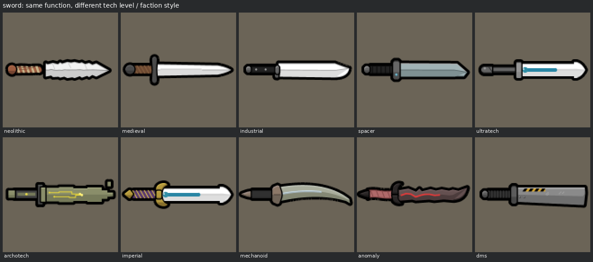
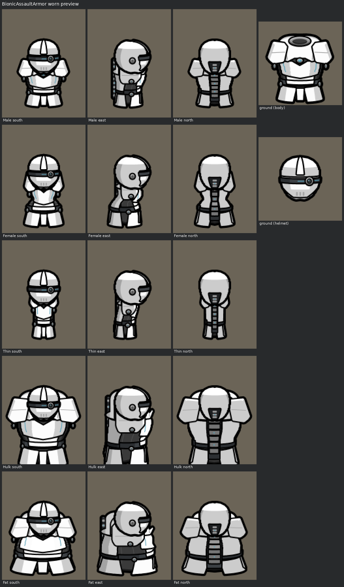

# rwtexturegen

A vector texture generator for **RimWorld mods**. You describe a weapon, an apparel set or a bionic
part as a small spec, and it renders game-ready 128px PNGs in the vanilla art style. It also writes
CutoutComplex masks, SVG sources, worn-on-pawn previews, a `graphicData` XML snippet and a lint
report.

It also contains reference material: a researched **style lexicon** with 12 tech levels and mod
house styles, measurements taken from vanilla art, and notes on Dead Man's Switch, EPOE-Forked,
Bionic Icons and Vanilla Expanded. With these, the same function (a sword, a rifle, a suit of
armor) can be designed in any tech level's visual language.

```bash
pip install -r requirements.txt
python -m rwtex build specs/                         # render every example
python -m rwtex matrix sword --out sword_matrix.png  # one sword in all 12 styles
python -m rwtex new sword --name MyBlade --style archotech --out specs/my_blade.yaml
```

## Gallery

| | |
|---|---|
| Persona monosword (vanilla recreation, persona tint) | `output/weapons/PersonaMonosword/PersonaMonosword_preview.png` |
| Persona monosword "Tidewarden" (new unique variant, masked) | `output/weapons/PersonaMonosword_Tidewarden/PersonaMonosword_Tidewarden_preview.png` |
| Arc glaive "Halcyon" (unique ultratech melee weapon) | `output/weapons/ArcGlaive_Halcyon/ArcGlaive_Halcyon_preview.png` |
| Assault rifle "Ironclad" plus an Odyssey-style unique variant | `output/weapons/AssaultRifle_Ironclad/*_preview.png` |
| Charge assault rifle | `output/weapons/ChargeAssaultRifle/ChargeAssaultRifle_preview.png` |
| Bionic assault armor and helmet (5 body types × 3 directions) | `output/apparel/BionicAssaultArmor/BionicAssaultArmor_worn_preview.png` |
| The same function in every style | `output/style_matrix/{sword,ranged,polearm,armor,helmet,bionic_part}.png` |




## How it works

RimWorld art is simple, flat shapes with a few crisp tones and thick black outlines. That makes it
a good fit for **vector shapes as the source of truth, rendered by a raster paint pass that copies
the vanilla recipe**:

1. **Shapes** (`rwtex/geom.py`): polygons and paths with chamfers, rounding, beziers, tapers and
   offsets.
2. **Parts** (`rwtex/render.py`): each `Part` has a shape, a calibrated `Material` (a base, light,
   shade and deep ramp sampled from vanilla) and shading operations: `Bevel`, `Split`, `Facets`
   (chamfered plates), `Dome`, `Gradient` and `Rim`. It can also carry details (engraved lines,
   vents, decals) and an emissive `Glow`.
3. **Rasteriser**: renders at 8× supersampling and then box-filters down.
   - It draws a thick pure-black outer silhouette outline (~3 px at 128) and thinner inner part
     lines.
   - It adds contact-shadow occlusion where parts overlap.
   - Transparent pixels keep black RGB, so no white halo appears after compression.
4. **3D form proxies for apparel** (`rwtex/form.py`, `rwtex/archetypes/armor3d.py`).
   - Each body type has an elliptic-cylinder torso fitted to its south and east silhouettes.
     Helmets sit on an ellipsoid head.
   - Armor plates are authored as surface patches and projected into each view, so horizontals
     bow and the neck ring is foreshortened. Side planes narrow, and back-facing parts disappear.
   - Facets are flat-shaded from real normals with vanilla's quantised tones: white fronts, grey
     sides and backs, dark undersides.
   - One design fits all 5 body types × 3 directions.
5. **Outputs** (`rwtex/export.py`, `rwtex/preview.py`, `rwtex/lint.py`):
   - PNGs, plus `_m` / `southm` masks for CutoutComplex.
   - SVGs.
   - Previews at 1×/2×/4× with stuff and persona tints, and worn previews on synthetic pawns.
   - An XML snippet.
   - Lint against vanilla conventions: size, outline darkness and thickness, edge contact,
     transparent RGB and mask colours.

**Style lexicon** (`rwtex/data/lexicon.yaml` → [docs/STYLE_LEXICON.md](docs/STYLE_LEXICON.md)):
there are 12 styles: neolithic, medieval, industrial, spacer, ultratech, archotech, imperial,
mechanoid, anomaly, dms, bionic and vanilla_expanded. Each one has:

- a shape grammar (corners, irregularity, bulk, taper, ornament, segmentation)
- material roles
- motifs
- do / don't rules
- in-game and mod references

Every archetype reads the style, so `sword(style='archotech')` and `sword(style='neolithic')`
are the same function in two visual languages.

## Layout

```
rwtex/                  the generator (pure Python: Pillow + numpy + PyYAML)
  geom.py render.py     vector toolkit, scene graph, rasteriser, SVG export
  materials.py color.py calibrated palettes, stuff colours, tints, CutoutComplex maths
  form.py               3D torso/head proxies for perspective-correct apparel
  styles.py data/       style lexicon + measured body/head silhouette templates
  parts/                shared motifs (vents, rivets, circuits, hazard stripes...) + melee parts
  archetypes/           sword, polearm, rifle, bow, armor, helmet, bionic_part (+ armor3d designs)
  spec.py cli.py        spec files -> files on disk; command line
  preview.py lint.py    previews and QA
specs/                  the example specs (YAML + one Python spec)
output/                 rendered examples (PNG, masks, SVG, previews, XML, lint)
docs/                   style guide, mod styles, lexicon, archetype reference, workflow
.claude/skills/         Claude Code skill: how to use this repo when modding
```

## Documentation

- [docs/WORKFLOW.md](docs/WORKFLOW.md): the multi-pass review loop and how to go from idea to a
  texture in the game.
- [docs/ARCHETYPES.md](docs/ARCHETYPES.md): every archetype parameter and the Python spec / parts
  API.
- [docs/STYLE_LEXICON.md](docs/STYLE_LEXICON.md): the style vocabulary, generated from the YAML.
- [docs/STYLE_GUIDE.md](docs/STYLE_GUIDE.md): vanilla conventions and measurements (sizes,
  outlines, palettes, orientation, masks, file naming).
- [docs/MOD_STYLES.md](docs/MOD_STYLES.md): Dead Man's Switch, EPOE-Forked, Bionic Icons and
  Vanilla Expanded.
- [CLAUDE.md](CLAUDE.md): instructions for Claude Code sessions working in this repo.

## Attribution and assets

- **No Ludeon or mod art is included.**
  - The colours and dimensions in the docs and materials were measured from the official art
    source, the game textures and mod pages.
  - `rwtex/data/templates.json` stores only row extents of the vanilla body and head
    silhouettes, which are measurements, not pixels.
  - Preview pawns are synthetic shapes drawn from those extents.
- RimWorld is © Ludeon Studios. Dead Man's Switch, EPOE-Forked, Vanilla Expanded and Bionic
  Icons (MIT, AUTOMATIC1111) belong to their authors. They are cited here as style references only.
- Generated textures are yours to use in your mods.
